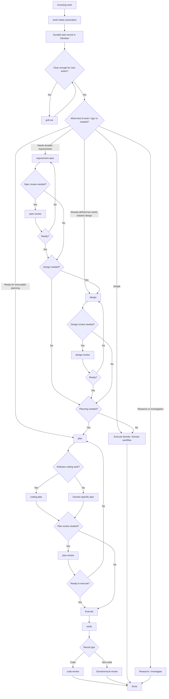
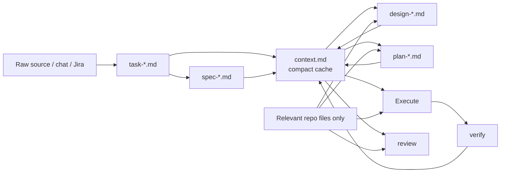

# Agent Work Skills

A generic work workflow with specialized software-engineering stages. The system is **artifact-driven**: each skill has one job, stages are optional, and the durable task record in Obsidian is the handoff point between agents/tools.

Two commands:

| Command | What it does |
|---------|----------------|
| `/workflow-loop-fast` | The agent runs the smallest stage path until a result or a human gate. |
| `/workflow-high` | Intake, then you finish the task. When you say it is ready, one skill starts. For a clear code change, that skill is `coding-plan` and it shows the test input and output for you to review before any production code. If the task is not that specific, the skill is `design` or a normal plan. |

[`CLAUDE.md`](CLAUDE.md) is optional personal thinking. It is not part of the install. `./scripts/link-skills.sh` copies skills only. `./scripts/install-center.sh` installs `CLAUDE.md` when you want it, and it will not replace a file you already have.

## Install as a plugin

One repo, three manifests. Skills stay in `skills/*/SKILL.md`. Bump `version` in every manifest together when you release.

| Host | Manifest | Install |
|------|----------|---------|
| Codex | [`plugin.json`](plugin.json) + [`.agents/plugins/marketplace.json`](.agents/plugins/marketplace.json) | `codex plugin marketplace add .` then install **markkj-skills** |
| Claude Code | [`.claude-plugin/plugin.json`](.claude-plugin/plugin.json) | `claude plugin marketplace add .` then `claude plugin install markkj-skills@markkj-skills` |
| Cursor | [`.cursor-plugin/plugin.json`](.cursor-plugin/plugin.json) | Load this repo as a local plugin |

`problem-decompose` asks the agent to apply it on every task. `humanizer` applies whenever the agent writes sentences a person will read, in a file or in chat. The other skills run when a mode or you names them.

**Token use:** These skills are not well optimized for tokens yet. They can pull in more context than a task needs. Treat that as known, not as the target.

## Core model

```text
Capture -> Clarify -> Define -> Design -> Plan -> Execute -> Verify -> Review
```

Not every task uses every stage.

[`workflow`](skills/workflow/SKILL.md) only asks which command to run. [`workflow-loop-fast`](skills/workflow-loop-fast/SKILL.md) runs the path below and pauses when a stage needs the user (empty **A:**, review **Your call**, coding-plan diagram confirm). [`workflow-high`](skills/workflow-high/SKILL.md) stops after intake until you say the task is ready.

- **Capture** — `work-intake-automation`: what work exists?
- **Clarify** — `grill-me`: what is ambiguous or assumed?
- **Define** — `requirement-spec`: what exactly should be true?
- **Design** — `design`: how should it work?
- **Plan** — `plan`: what executable steps will we take? It opens `coding-plan` only when the task clearly asks to write or change code.
- **Verify** — `verify`: did the result satisfy the task/spec?
- **Review** — artifact-specific review: is this artifact/result good enough to proceed?

## Workflow diagram



## Recommended paths

### Small task

```text
work-intake-automation -> coding-plan -> verify (when useful)
```

### Clear software change

```text
work-intake-automation
-> plan                      # opens coding-plan for this clear code change
-> execute
-> verify
-> code-review
```

### Normal feature

```text
work-intake-automation
-> grill-me?             # only if unclear
-> requirement-spec
-> one next step:
   design, then stop                         # how it should work is still open
   plan                                  # opens coding-plan only for a clear code job
     plan-review? -> execute -> verify -> code-review
                                           # only when plan opened coding-plan
```

### High-risk / platform / architecture change

Same fork as a normal feature. Always run `grill-me` and `spec-review`. Add `design-review` only when that fork includes `design`.

### Non-coding work

```text
work-intake-automation
-> grill-me?             # ambiguity only
-> requirement-spec?     # durable definition only when useful
-> research / investigate / write / operate / execute
-> verify / result review when useful
```

`work-intake-automation` is intentionally domain-agnostic. A task does **not** become a coding task just because it was captured here.

## Artifact ownership

```text
Projects/<PROJECT_NAME>/<WORK_ID>/          # same folder as task-*.md
├── task-<slug>.md                 # work-intake-automation: durable ledger
├── context.md                     # compact handoff cache; created lazily
├── requirement-spec-<slug>.md     # requirement-spec: optional; one or more over time
├── design-<slug>.md               # design: optional; one or more over time
├── plan-<slug>.md                 # plan, or coding-plan when the job is code
└── discussion/                    # questions + reviews — never repo root
    ├── spec-review-<slug>.md
    ├── design-review-<slug>.md
    └── verification-<slug>.md
```

For Cursor plans, the **Obsidian plan is the origin** and `~/.cursor/plans/*.plan.md` is a symlink. Product code goes through `coding-plan`, which creates the git worktree here:

```text
~/workspace/working-place/<WORK_NAME>/<repo-name>
```

with branch:

```text
mark/<WORK_NAME>
```

## Token-efficient context flow

Each stage should receive **artifacts, not conversation history**. The shared policy lives in [`CONTEXT.md`](CONTEXT.md), with a reusable template at [`templates/context.md`](templates/context.md).



The intended compression model is:

```text
raw source/history
    -> normalized task
    -> compact confirmed context
    -> stage-specific artifact
    -> smallest sufficient handoff to next stage
```

`context.md` is **not another log**. Keep it bounded (target <= ~1,200 words), rewrite stale information, preserve only confirmed facts/decisions/relevant code pointers/open blockers, and link to authoritative artifacts instead of copying them. `work-intake-automation` does not create it; later stages create it lazily when useful.

## Skill boundaries

| Skill | Question it answers | Must not own |
|---|---|---|
| `workflow` | Which command, fast or high? | Running the work itself |
| `workflow-loop-fast` | Which smallest path, when do we pause, and when is the next stage a different job for a sub-agent? | Replacing a stage skill, filling **A:** / **Your call**, or opening `coding-plan` for a vague task |
| `workflow-high` | When is the task ready, and which one skill starts? | Looping stages, opening `coding-plan` when the task does not ask to write code, or writing code before the test is accepted |
| `problem-decompose` | What is the problem, split small, with Soln/Pros/Cons — and what must we ask instead of assuming? (**auto-apply**) | spec/design/plan artifacts; full `grill-me` sessions |
| `humanizer` | Do these sentences match our plain voice, wherever they are written? (**auto-apply**) | Chat problem format; code, commands, identifiers; required headings, YAML, links, checkboxes |
| `work-intake-automation` | What work exists and where is its durable record? | spec/design/plan/code |
| `grill-me` | What are we missing or assuming? | solution design / implementation plan |
| `requirement-spec` | What should be true? | architecture / implementation order |
| `spec-review` | Is the definition complete and testable? | implementation |
| `design` | How should the desired behavior work? | file-level execution todos |
| `design-review` | Is this a sound solution to the spec? | code changes |
| `plan` | What are the steps, and does this job use `coding-plan`? | foundational requirements/design decisions; a second plan file when `coding-plan` writes the plan |
| `coding-plan` | How do we implement this software change safely? | changing agreed requirements silently |
| `plan-review` | Is the plan safe and executable? | implementation |
| `verify` | Did the result satisfy the contract? | assuming tests alone prove completion |
| `code-review` | Is the actual code correct against task/spec/design/plan? | redefining requirements |
| `daily-check-in` | What should we do today, from open tasks and yesterday's log? | editing tasks, specs, designs, or plans |

## Routing principle

Use the **smallest workflow that preserves correctness**. Stages are gates, not ceremony.

A solid task may skip `grill-me`. A tiny task may skip `requirement-spec`, `design`, and planning. A research task may never touch `coding-plan`. A risky platform change may use every review gate.
