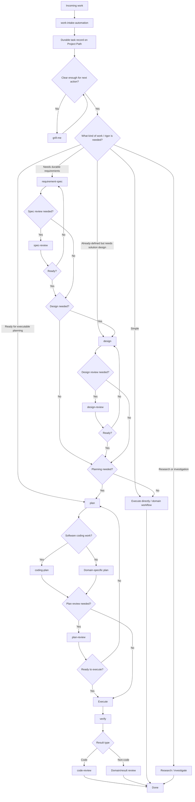
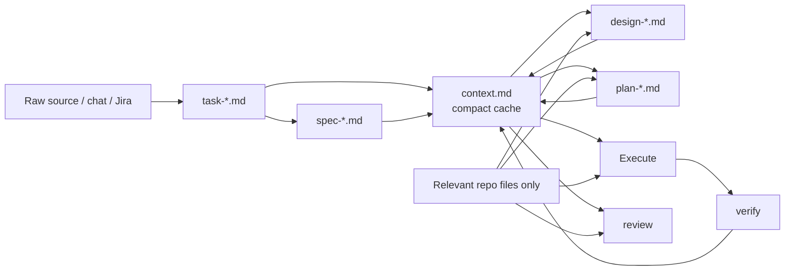

# markkj-skills

A Claude Code plugin for artifact-driven work. Each skill does one job: capture a task, clarify it, write a spec, a design or a plan, then verify and review the result. Stages are optional. The task record in your Project Path folder is what one stage hands to the next.

The plugin also tracks each task: a band above the prompt shows the task and current step, and a report shows tokens and estimated cost per task and per step.

## Requirements

- Claude Code
- Node.js 18 or newer (the hooks run on Node)
- git
- macOS or Linux

## Install

Clone the repo, then run the installer from it.

**On in every session:**

```sh
./scripts/install-claude-plugin.sh
```

**Per session (recommended):**

```sh
./scripts/install-claude-plugin.sh --per-session
source ~/.zshrc   # or open a new shell
```

The plugin stays off until you start a session with `claude-kj`. A session cannot turn it on after it starts, so pick `claude-kj` when you open the session.

### What the installer does

| Step | Command it runs | Plain install | `--per-session` |
|------|-----------------|:-------------:|:---------------:|
| 1. Add this repo as a plugin source | `claude plugin marketplace add ./`, or `marketplace update` when already added | ✓ | ✓ |
| 2. Install the plugin | `claude plugin install markkj-skills@markkj-skills` | ✓ | ✓ |
| 3. Remove old skill copies | deletes folders in `~/.claude/skills` that hold the `.markkj-skills-installed` marker | ✓ | ✓ |
| 4. Turn the plugin off by default | `claude plugin disable markkj-skills@markkj-skills` | | ✓ |
| 5. Add the `claude-kj` alias | writes one block to `~/.zshrc` (or `~/.bashrc`) | | ✓ |

Step 3 is there because the old `link-skills.sh` copied skills into `~/.claude/skills`. Those copies loaded beside the plugin, so every skill showed up twice, even with the plugin off. Folders without the marker, such as skills from other packs, are left alone.

The alias in step 5 sits between two marker lines:

```sh
# >>> markkj-skills claude-kj >>>
alias claude-kj='claude --settings '"'"'{"enabledPlugins":{"markkj-skills@markkj-skills":true}}'"'"''
# <<< markkj-skills claude-kj <<<
```

`--settings` turns the plugin on for that one session only. Your saved settings keep it off.

After a per-session install:

| You type | You get |
|----------|---------|
| `claude` | A plain session with no markkj skills, hooks or band |
| `claude-kj` | The skills, the band, tracking and the report |

Run the installer again at any time. It updates the marketplace instead of adding it twice, and replaces the alias block instead of adding another one.

### Update

The plugin is read straight from this folder. Pull the repo, then run `/reload-plugins` in an open session, or start a new one.

### Uninstall

```sh
claude plugin uninstall markkj-skills@markkj-skills
claude plugin marketplace remove markkj-skills
```

Then delete the lines between `# >>> markkj-skills claude-kj >>>` and `# <<< markkj-skills claude-kj <<<` in your shell rc file.

## Use

Two commands start the workflow:

| Command | What it does |
|---------|--------------|
| `/workflow-loop-fast` | Runs the smallest stage path until there is a result or a step needs you. |
| `/workflow-high` | Runs intake, then waits until you say the task is ready. Then one skill starts. For a clear code change that is `coding-plan`, which shows the test input and output for you to review before any production code. Otherwise it is `design` or a normal plan. |

You can also call any skill by name, for example `/plan` or `/design`. Claude can also pick a skill on its own when your request matches its description.

`problem-decompose` applies to every task. `humanizer` applies whenever Claude writes sentences a person will read, in a file or in chat. The other skills run when a command or you name them.

**Token use:** the skills are not tuned for tokens yet. They can pull in more context than a task needs.

## Configure

### Project Path

Run this once:

```sh
./scripts/resolve-project-path.sh
```

It prints one folder and saves it in `~/.config/markkj-skills/project-path`. Task folders live there:

```text
$PROJECT_PATH/<PROJECT_NAME>/<WORK_ID>/
```

If that file is missing and `OBSIDIAN_BASE_VAULT_PATH` points at an existing folder, the script creates `$OBSIDIAN_BASE_VAULT_PATH/Projects` and saves that path. A saved path is never changed.

### Plugin setting

| Setting | Default | What it does |
|---------|---------|--------------|
| `track_turns` | on | Writes `usage.jsonl` and `report.html` after each turn, and shows the band. Change it in the `/plugin` menu. |

### Environment variables

| Variable | Default | What it does |
|----------|---------|--------------|
| `MARKKJ_CONFIG_DIR` | `$XDG_CONFIG_HOME/markkj-skills`, else `~/.config/markkj-skills` | Where the ledger, report, Project Path file and wraps live. |
| `PROJECT_PATH` | the saved Project Path | Overrides the saved Project Path. |
| `MARKKJ_WORKTREE_ROOT` | `~/workspace/working-place` | Where `coding-plan` worktrees live. Tracking reads the task name from this path. |

## Task tracking

The plugin's hooks are [`hooks/claude-hooks.json`](hooks/claude-hooks.json) (Stop, SubagentStop, UserPromptSubmit) and [`hooks/claude-band.json`](hooks/claude-band.json) (the band).

```text
~/.config/markkj-skills/
  project-path
  usage.jsonl     # one row per turn and per subagent run
  report.html     # every task, grouped
  wraps/<skill>.txt
```

**Band.** A line above the prompt reads `markkj · <task> · <step> · open report`. It shows this session only and updates after each turn. The button opens `report.html` in your browser.

**Task.** A turn belongs to the task whose `task-*.md` sits in the working folder or a parent folder. In a `coding-plan` worktree, the task is the work name from the path `<worktree root>/<WORK_NAME>/<repo>`, or from the branch `mark/<WORK_NAME>`.

**Step (action).** The step is the last markkj skill called in the session, through the Skill tool or a slash command. It stays until another markkj skill runs, so a follow-up turn such as "fix that" still counts toward that step. Skills from other plugins do not change it. Neither do `humanizer` and `problem-decompose`, which load on almost every turn. Turns before any markkj skill count as `other`.

**Tokens.** A turn's tokens are the sum of every API call since your last prompt. Subagent runs get their own row in the parent session, marked with the agent type. Their tokens come from the subagent's own transcript. Their step is the markkj skill they called, or the parent's step when they called none.

**Cost.** The report shows an estimate at Anthropic API list prices, from [`hooks/prices.json`](hooks/prices.json). Cache writes count at 2× the input price for the 1-hour cache and 1.25× for the 5-minute cache. On a Claude subscription you are not billed per token, so read it as a way to compare tasks, not as a bill. A model missing from the table shows `—`. A total marked `+` leaves some turns out. Update `prices.json` when prices change.

## Wraps

Other skills attach through a list, not through the skill text. Put one skill name per line:

```text
~/.config/markkj-skills/wraps/code-review.txt
ponytail
```

When `code-review` runs, the prompt hook tells Claude to load each installed skill named in that file. A missing file or a missing skill is skipped. `code-review` itself does not name ponytail.

## Core model

```text
Capture -> Clarify -> Define -> Design -> Plan -> Execute -> Verify -> Review
```

Not every task uses every stage.

[`workflow`](skills/workflow/SKILL.md) only asks which command to run. [`workflow-loop-fast`](skills/workflow-loop-fast/SKILL.md) runs the path below and pauses when a stage needs the user (empty **A:**, review **Your call**, coding-plan diagram confirm). [`workflow-high`](skills/workflow-high/SKILL.md) stops after intake until you say the task is ready.

- **Capture** — `work-intake-automation`: what work exists?
- **Clarify** — `grill-me`: what is ambiguous or assumed?
- **Define** — `requirement-spec`: what exactly should be true?
- **Design** — `design`: how should it work?
- **Plan** — `plan`: what executable steps will we take? It opens `coding-plan` only when the task clearly asks to write or change code.
- **Verify** — `verify`: did the result satisfy the task/spec?
- **Review** — artifact-specific review: is this artifact/result good enough to proceed?

## Workflow diagram



## Recommended paths

### Small task

```text
work-intake-automation -> coding-plan -> verify (when useful)
```

### Clear software change

```text
work-intake-automation
-> plan                      # opens coding-plan for this clear code change
-> execute
-> verify
-> code-review
```

### Normal feature

```text
work-intake-automation
-> grill-me?             # only if unclear
-> requirement-spec
-> one next step:
   design, then stop                         # how it should work is still open
   plan                                  # opens coding-plan only for a clear code job
     plan-review? -> execute -> verify -> code-review
                                           # only when plan opened coding-plan
```

### High-risk / platform / architecture change

Same fork as a normal feature. Always run `grill-me` and `spec-review`. Add `design-review` only when that fork includes `design`.

### Non-coding work

```text
work-intake-automation
-> grill-me?             # ambiguity only
-> requirement-spec?     # durable definition only when useful
-> research / investigate / write / operate / execute
-> verify / result review when useful
```

`work-intake-automation` is intentionally domain-agnostic. A task does **not** become a coding task just because it was captured here.

## Artifact ownership

```text
$PROJECT_PATH/<PROJECT_NAME>/<WORK_ID>/          # same folder as task-*.md
├── task-<slug>.md                 # work-intake-automation: durable ledger
├── context.md                     # compact handoff cache; created lazily
├── requirement-spec-<slug>.md     # requirement-spec: optional; one or more over time
├── design-<slug>.md               # design: optional; one or more over time
├── plan-<slug>.md                 # plan, or coding-plan when the job is code
└── discussion/                    # questions + reviews — never repo root
    ├── spec-review-<slug>.md
    ├── design-review-<slug>.md
    └── verification-<slug>.md
```

Product code goes through `coding-plan`, which creates the git worktree here:

```text
~/workspace/working-place/<WORK_NAME>/<repo-name>
```

with branch:

```text
mark/<WORK_NAME>
```

## Token-efficient context flow

Each stage should receive **artifacts, not conversation history**. The shared policy lives in [`CONTEXT.md`](CONTEXT.md), with a reusable template at [`templates/context.md`](templates/context.md).



The intended compression model is:

```text
raw source/history
    -> normalized task
    -> compact confirmed context
    -> stage-specific artifact
    -> smallest sufficient handoff to next stage
```

`context.md` is **not another log**. Keep it bounded (target <= ~1,200 words), rewrite stale information, preserve only confirmed facts/decisions/relevant code pointers/open blockers, and link to authoritative artifacts instead of copying them. `work-intake-automation` does not create it; later stages create it lazily when useful.

## Skill boundaries

| Skill | Question it answers | Must not own |
|---|---|---|
| `workflow` | Which command, fast or high? | Running the work itself |
| `workflow-loop-fast` | Which smallest path, when do we pause, and when is the next stage a different job for a sub-agent? | Replacing a stage skill, filling **A:** / **Your call**, or opening `coding-plan` for a vague task |
| `workflow-high` | When is the task ready, and which one skill starts? | Looping stages, opening `coding-plan` when the task does not ask to write code, or writing code before the test is accepted |
| `problem-decompose` | What is the problem, split small, with Soln/Pros/Cons — and what must we ask instead of assuming? (**auto-apply**) | spec/design/plan artifacts; full `grill-me` sessions |
| `humanizer` | Do these sentences match our plain voice, wherever they are written? (**auto-apply**) | Chat problem format; code, commands, identifiers; required headings, YAML, links, checkboxes |
| `work-intake-automation` | What work exists and where is its durable record? | spec/design/plan/code |
| `grill-me` | What are we missing or assuming? | solution design / implementation plan |
| `requirement-spec` | What should be true? | architecture / implementation order |
| `spec-review` | Is the definition complete and testable? | implementation |
| `design` | How should the desired behavior work? | file-level execution todos |
| `design-review` | Is this a sound solution to the spec? | code changes |
| `plan` | What are the steps, and does this job use `coding-plan`? | foundational requirements/design decisions; a second plan file when `coding-plan` writes the plan |
| `coding-plan` | How do we implement this software change safely? | changing agreed requirements silently |
| `plan-review` | Is the plan safe and executable? | implementation |
| `verify` | Did the result satisfy the contract? | assuming tests alone prove completion |
| `code-review` | Is the actual code correct against task/spec/design/plan? | redefining requirements |
| `daily-check-in` | What should we do today, from open tasks and yesterday's log? | editing tasks, specs, designs, or plans |

## Routing principle

Use the **smallest workflow that preserves correctness**. Stages are gates, not ceremony.

A solid task may skip `grill-me`. A tiny task may skip `requirement-spec`, `design`, and planning. A research task may never touch `coding-plan`. A risky platform change may use every review gate.

## Repository layout

```text
.claude-plugin/
  plugin.json          # plugin manifest: hooks, settings
  marketplace.json     # local marketplace for the installer
  icon.png
hooks/
  claude-hooks.json    # Stop, SubagentStop, UserPromptSubmit
  claude-band.json     # the band module
  band/register.tsx    # band: task, step, open report
  record-turn.js       # writes usage.jsonl and report.html
  prices.json          # model prices for cost estimates
  on-stop.sh, on-prompt.sh, wrap-prompt.js
skills/<name>/SKILL.md # one folder per skill
templates/             # shared templates the skills use
scripts/
  install-claude-plugin.sh
  install-center.sh    # optional: link CLAUDE.md
  resolve-project-path.sh
  test.sh              # run every test and validate the plugin
  tests/
```

## Develop

```sh
./scripts/test.sh
```

This runs every test in `scripts/tests/` and `claude plugin validate`. Add a `*_test.sh` file there for new behavior. Each test is a plain shell script that prints `ok` or exits non-zero.

To try a change, edit the files, then run `/reload-plugins` in a session.

To release, bump `version` in [`.claude-plugin/plugin.json`](.claude-plugin/plugin.json).

## Optional: CLAUDE.md

[`CLAUDE.md`](CLAUDE.md) holds personal thinking rules. It is not part of the plugin. To use it on your machine:

```sh
./scripts/install-center.sh
```

This links it to `~/.claude/CLAUDE.md`. It will not replace a `CLAUDE.md` you already have.

## License

MIT. See [`LICENSE`](LICENSE).
